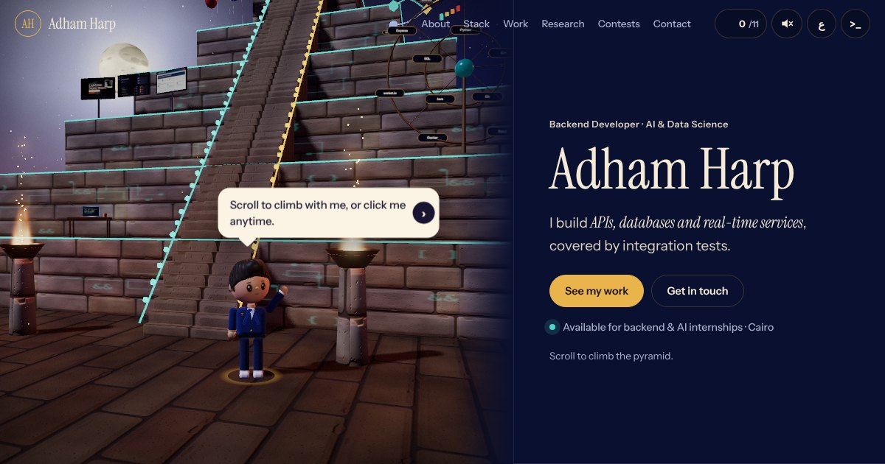

# Adham Harp — 3D portfolio

[](https://adham-harp.github.io/)

**Live:** https://adham-harp.github.io/

A scroll-driven 3D portfolio built as Djoser's step pyramid at night: every step is one layer of my stack, and a mini version of me climbs it with you and explains each level (English or Egyptian Arabic).

Built with [three.js](https://github.com/mrdoob/three.js), [GSAP](https://github.com/greensock/GSAP) (ScrollTrigger, SplitText) and [Lenis](https://github.com/darkroomengineering/lenis). Every 3D shape, texture and sound is generated in code: no 3D model or audio files. The only images are the project screenshots.

## Features

- **A guide with moods.** Mini-Adham has a painted, expressive face and 13 moods (happy, excited, focused, thinking, cool, surprised, shy, annoyed, sleepy, dizzy, love, worried, vibing). They change with the level, with what you do (poke him, scroll too fast, leave him idle, turn the music on) and he puts on sunglasses or headphones when the mood calls for it.
- **Contact form that delivers.** Messages go straight to my inbox through [Web3Forms](https://web3forms.com), with the HTTP request and response shown live, a honeypot against bots and an email fallback.
- **Live demos inside the pyramid.** "Try it in 3D" flies to a monitor and mounts the project's real, live demo on it (CSS3D), so you can use SmartHabbit, BU-LabTrack or CAPCOM without leaving the page. On phones the monitor turns to portrait.
- **Gamified.** 11 hidden artifacts to collect, a Balloon Rush mini-game in the Arena, an attack simulator that drives the IoT Sentinel hologram, and a terminal (`help`, `mood cool`, `sudo hire adham`).
- **Physically based rendering.** Procedural sandstone (albedo, normal and roughness maps), sky-based environment lighting, soft moon shadows, ambient occlusion (GTAO), bloom and a light film grade.
- Tech logos from [Simple Icons](https://simpleicons.org), and generated sound (off by default): desert wind and a Hijaz-mode drone with oud-like plucks.
- Arrow-key navigation, adaptive quality for slower devices, reduced-motion support, English / Egyptian Arabic guide.

## Run it

```bash
npm install
./build.sh                 # bundles src/ into dist/app.js
python -m http.server 8000 # open http://localhost:8000
```

## Deploy on GitHub Pages

Push this folder to a repo (for example `adham-harp.github.io`), then Settings → Pages → Deploy from branch → `main` / root. `dist/app.js` is committed, so no build step is needed on GitHub.

## Where things live

| File | What it does |
|---|---|
| `index.html` | All the text content (edit your projects here) |
| `css/style.css` | Layout, panels, bubble, terminal |
| `src/world.js` | Sky, dunes, the pyramid, stairs, packets, props per level |
| `src/guide.js` | Mini-Adham: body, face, animations, and the climbing path |
| `src/lines.js` | What mini-Adham says on each level (EN + AR) |
| `src/textures.js` | Procedural PBR textures (stone, sand, moon) |
| `src/sound.js` | WebAudio ambience and effects |
| `src/achievements.js` | The 11 hidden artifacts |
| `src/main.js` | Scroll → camera/character, post-processing, live demo screens, bubble, terminal, contact form |
| `smarthabbit/`, `capcom/` | Static builds of those projects, served from this site so they can run inside the 3D monitors |
| `assets/shots/` | Project screenshots shown on the monitors and cards |

Easter eggs: press <kbd>`</kbd> for the terminal (`help`, `sudo hire adham`), click mini-Adham to poke him.
